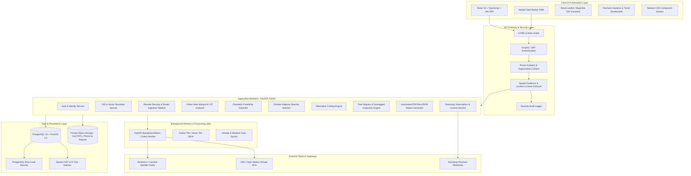
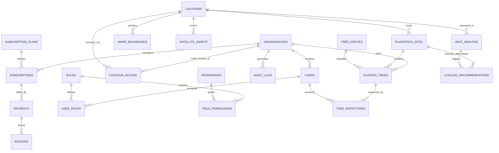

# Smart Urban Heat & Climate Resilience Platform
## Master System Blueprint, PRD & Architecture Specification
**Problem Track:** CTBF-SU-06 · Urban Heat and Tree-Plantation Planner Using Satellite Data  
**Focus Pilot:** Jalandhar, Punjab, India (Designed for National & Global Multi-Tenant Scale)  
**Document Version:** 1.0.0 · Production Architecture Standard  

---

## 1. Product Requirements Document (PRD)

### 1.1 Executive Summary & Problem Context
Punjab's cities, notably industrial and high-density hubs like Jalandhar, Ludhiana, and Amritsar, experience intense summer heatwaves with land-surface temperatures (LST) frequently exceeding 45°C–48°C. Rapid urbanization, concrete paving, loss of wetlands, and dense built-up zones create severe Urban Heat Islands (UHI). Concurrently, municipal and community tree-plantation drives frequently fail due to:
1. **Misplaced Plantations:** Planting in areas that already have canopy while extreme heat hotspots with zero shade are neglected.
2. **Incompatible Species Selection:** Planting non-native or water-intensive species (e.g., Conocarpus or water-thirsty Eucalyptus) unsuited for dropping groundwater tables and future +2°C–3°C climatic extremes.
3. **Space & Infrastructure Constraints:** Attempting plantations on narrow rights-of-way, over utility lines, or in dense commercial bazaars where tree roots destroy paving or overhead cables interfere, while ignoring viable alternatives like cool roofs or vertical greenery.
4. **Lack of Survival Accountability:** Over 60%–70% of urban saplings die within 12 months without geo-referenced post-plantation tracking, watering validation, or survival audits.
5. **Data Silos & Commercial Licensing Gaps:** Municipalities, private developers, and universities lack unified, tenant-isolated access to verified thermal remote-sensing and vegetation indices.

### 1.2 Target Personas & Value Proposition
| Persona | Key Pain Points | Platform Solution |
| :--- | :--- | :--- |
| **Municipal Commissioner / Ward Councillor** | Budget waste on dying saplings; public outrage over heatwaves; lack of spatial priorities. | Ward-ranked heat hotspot maps; automated budget and plantation feasibility scoring; empirical cooling impact reports. |
| **Urban Town Planner / GIS Engineer** | Manual GIS digitisation takes months; satellite data processing requires complex specialized desktop GIS software. | Automated Sentinel-2 NDVI & Landsat 8/9 LST processing pipelines with instant GeoJSON ward-level aggregation and raster exports. |
| **Corporate ESG / Real Estate Developer** | Needs licensed climate-resilience intelligence for specific campuses without exposing other proprietary plots. | Multi-tenant licensed polygon access; verified carbon and shade metrics for ESG disclosures; cool roof vs. green corridor recommendations. |
| **Horticulture Officer / Field Worker** | Paper-based sapling logging; no audit trail of watering, pruning, or sapling mortality. | Mobile-first GPS-tagged photo logging; 3/6/12-month survival audit workflows; offline-friendly field inspection forms. |
| **Platform Super Admin** | Managing multiple municipal clients, controlling geographical licensing, preventing spatial data leakage. | ABAC/RBAC tenant isolation; spatial polygon licence management; billing, usage tracking, and security audit logs. |

### 1.3 Core Product Workflow: The 6-Step Loop
$$\text{ANALYSE} \longrightarrow \text{IDENTIFY} \longrightarrow \text{RECOMMEND} \longrightarrow \text{IMPLEMENT} \longrightarrow \text{MONITOR} \longrightarrow \text{IMPROVE}$$

1. **ANALYSE:** Ingest Landsat-8/9 Thermal Infrared (TIRS) and Sentinel-2 Multispectral bands. Compute Land Surface Temperature (LST via split-window/single-channel radiative transfer), Normalized Difference Vegetation Index (NDVI), and Normalized Difference Built-up Index (NDBI).
2. **IDENTIFY:** Cross-overlay high LST ($>38^\circ\text{C}$ in summer), low NDVI ($<0.15$), and high NDBI ($>0.2$) to isolate Hyperlocal Heat Hotspots at 30m resolution across municipal wards.
3. **RECOMMEND:**
   - **Plantation Feasibility:** Assess ground space, soil permeability, road widths, and overhead clearances.
   - **Climate-Adaptive Species:** Algorithmic matching with Punjab’s agro-climatic zone (e.g., *Azadirachta indica* (Neem), *Dalbergia sissoo* (Tahli/Shisham), *Vachellia nilotica* (Kikar), *Terminalia arjuna* (Arjun), *Ficus religiosa* (Peepal)) considering drought, rooting depth, and heat resilience.
   - **Alternative Cooling:** Where ground planting is unviable (e.g., Jalandhar Rainak Bazaar, Phagwara Gate electronics market), recommend high-albedo cool roofs ($SRI > 78$), green roofs, vertical bioswales, and tensile solar shade shelters.
4. **IMPLEMENT:** Generate geo-referenced ward action plans with ranked planting coordinates and civil intervention specs.
5. **MONITOR:** Field workers log planted saplings with sub-5m GPS coordinates, species tags, and timestamped photos. Automatic inspection schedules fire at Day 0, Day 90, Day 180, and Day 365.
6. **IMPROVE:** Re-evaluate satellite thermal and vegetation trajectories over multi-year cycles to measure actual micro-climate cooling trends.

---

## 2. Comprehensive System Architecture

---

## 3. Database Entity-Relationship (ER) Schema

---

## 4. Role & Permission Matrix (RBAC + ABAC)

### 4.1 System Roles
1. **SUPER ADMIN (Platform Owner):** Multi-tenant management, geographical catalog creation, global satellite ingestion oversight, subscription plan configuration, security audit logs.
2. **ORGANISATION ADMIN (Client Municipal/Corporate Head):** Manages org users, purchases and views licensed locations, reviews high-level analytics and reports, assigns field workers.
3. **ANALYST (GIS / Climate Specialist):** Generates heat and vegetation models, runs species recommendation scenarios, inspects satellite layers for licensed polygons, exports reports.
4. **VIEWER (Auditor / Executive):** Read-only dashboards and compliance reports for licensed locations.
5. **FIELD WORKER (Horticulture Ground Staff):** Mobile portal access only; conducts GPS-tagged tree registration, logs 3/6/12-month inspections with photos, reports damaged saplings.

### 4.2 RBAC Matrix
| Functionality / Resource | Super Admin | Org Admin | Analyst | Viewer | Field Worker |
| :--- | :---: | :---: | :---: | :---: | :---: |
| **Manage Organizations & Platform Config** | ✅ | ❌ | ❌ | ❌ | ❌ |
| **Create/Edit Cities & Ward GIS Polygons** | ✅ | ❌ | ❌ | ❌ | ❌ |
| **Upload Raw Satellite Scenes / Configure Pipeline** | ✅ | ❌ | ❌ | ❌ | ❌ |
| **Manage Org Users & Subscriptions** | ✅ (All) | ✅ (Own Org) | ❌ | ❌ | ❌ |
| **View Licensed Location Maps & Heatmaps** | ✅ (All) | ✅ (Licensed) | ✅ (Licensed) | ✅ (Licensed) | ❌ |
| **Run Hotspot & Species Analysis** | ✅ | ✅ | ✅ | ❌ | ❌ |
| **Generate & Export Executive Climate Reports** | ✅ | ✅ | ✅ | ✅ | ❌ |
| **Register Planted Trees & Assign Sites** | ✅ | ✅ | ✅ | ❌ | ✅ (Assigned) |
| **Submit Geotagged Tree Inspections** | ✅ | ✅ | ❌ | ❌ | ✅ (Assigned) |
| **Access Unlicensed Geographical Polygons** | ❌ (Strict) | ❌ (Strict) | ❌ (Strict) | ❌ (Strict) | ❌ (Strict) |

---

## 5. Comprehensive API Endpoint Plan

### 5.1 Identity & Access (`/api/v1/auth`)
- `POST /api/v1/auth/register` - Organization and primary administrator registration.
- `POST /api/v1/auth/login` - OAuth2 password flow issuing JWT access and refresh tokens.
- `POST /api/v1/auth/mfa/setup` - Generates TOTP QR code for 2FA.
- `POST /api/v1/auth/mfa/verify` - Validates TOTP token.
- `POST /api/v1/auth/refresh` - Rotates expired access tokens.
- `GET /api/v1/auth/me` - Returns active session, organization, role, and licensed location IDs.

### 5.2 Organizations & User Management (`/api/v1/organisations`)
- `GET /api/v1/organisations/my-org` - Active tenant details, license quota, member counts.
- `GET /api/v1/organisations/members` - List organization users (Admin only).
- `POST /api/v1/organisations/members` - Invite/create Analyst, Viewer, or Field Worker.
- `PATCH /api/v1/organisations/members/{user_id}` - Update user status or role.

### 5.3 Location Licensing & GIS Management (`/api/v1/locations`)
- `GET /api/v1/locations` - Returns authorized location list (Cities, Wards, Polygons).
- `GET /api/v1/locations/{location_id}/geojson` - Returns validated MultiPolygon boundary (ABAC guarded).
- `POST /api/v1/locations` - [Super Admin] Create new city, district, or ward boundary with GeoJSON.
- `POST /api/v1/locations/licenses/assign` - [Super Admin] Grant organization access to specific wards.
- `GET /api/v1/locations/jalandhar/wards` - Jalandhar pilot ward directory with license status.

### 5.4 Satellite Ingestion & Processing (`/api/v1/satellite`)
- `GET /api/v1/satellite/scenes?location_id={id}` - List available Sentinel-2 & Landsat acquisitions.
- `POST /api/v1/satellite/process-job` - Trigger NDVI & LST calculation for a target polygon.
- `GET /api/v1/satellite/jobs/{job_id}` - Job execution progress (0-100%).
- `GET /api/v1/satellite/tiles/{asset_id}/{z}/{x}/{y}.png` - Authenticated map tile proxy with license verification.

### 5.5 Urban Heat Hotspot Engine (`/api/v1/heat-analysis`)
- `GET /api/v1/heat-analysis/summary?location_id={id}` - LST mean, max, standard deviation, and trend.
- `GET /api/v1/heat-analysis/hotspots?location_id={id}&severity=CRITICAL` - GeoJSON polygons of heat hotspots.
- `GET /api/v1/heat-analysis/ward-ranking` - Compares wards across Jalandhar by heat risk index.

### 5.6 Vegetation & Green Cover (`/api/v1/vegetation`)
- `GET /api/v1/vegetation/ndvi-distribution?location_id={id}` - Histogram of vegetation density.
- `GET /api/v1/vegetation/deficit-zones?location_id={id}` - High heat + low NDVI priority intervention zones.

### 5.7 Plantation Feasibility & Planning (`/api/v1/plantation-feasibility`)
- `POST /api/v1/plantation-feasibility/evaluate-point` - Lat/Lng spatial check for space, road width, utilities.
- `GET /api/v1/plantation-feasibility/candidate-sites?location_id={id}` - Pre-screened plantation parcels.
- `POST /api/v1/plantation-feasibility/sites` - Save validated planting site to inventory.

### 5.8 Climate-Adaptive Species Engine (`/api/v1/species`)
- `GET /api/v1/species` - Catalog of Punjab native & climate-resilient species.
- `POST /api/v1/species/recommend` - Inputs: Soil type, road width, groundwater depth, target microclimate. Outputs: Ranked species with suitability score, water requirements, and canopy alerts.

### 5.9 Alternative Cooling Solutions (`/api/v1/cooling-alternatives`)
- `POST /api/v1/cooling-alternatives/recommend` - Evaluates unplantable high-heat zones and outputs ranked civil interventions.
- `GET /api/v1/cooling-alternatives/catalog` - Technical specifications, costs, and cooling efficacies.

### 5.10 Tree Tracking & Geotagged Inspections (`/api/v1/trees`)
- `GET /api/v1/trees?location_id={id}` - List planted trees with live health statuses.
- `POST /api/v1/trees` - Register planted tree with sub-5m GPS coordinates and initial photo.
- `GET /api/v1/trees/{tree_id}` - Tree history, 3/6/12-month inspection timeline.
- `POST /api/v1/trees/{tree_id}/inspections` - Field worker inspection submission with geotagged photo.
- `GET /api/v1/trees/survival-metrics?location_id={id}` - Survival rate percentages by species and ward.

### 5.11 Subscriptions & Billing (`/api/v1/billing`)
- `GET /api/v1/billing/plans` - Monthly, annual, and per-ward enterprise pricing.
- `POST /api/v1/billing/orders` - Generates Razorpay order for selected locations.
- `POST /api/v1/billing/webhook` - Cryptographically verified Razorpay payment webhook handler.
- `GET /api/v1/billing/invoices` - Historical invoices with GST breakdowns.

### 5.12 Reporting & Audit Logs (`/api/v1/reports`, `/api/v1/admin`)
- `POST /api/v1/reports/ward-resilience/pdf` - Generates downloadable executive climate PDF report.
- `GET /api/v1/admin/audit-logs` - Platform-wide security access and permission breach logs.

---

## 6. Development Folder Structure
Detailed monorepo structure spanning:
- `backend/`: FastAPI application, security, ABAC guard, GIS services, remote sensing models, migrations, tests.
- `webApp/`: React 18, TypeScript, Tailwind CSS, Leaflet GIS mapping, Recharts dashboards.
- `docs/`: Technical manuals, Jalandhar spatial datasets, API definitions.
- `MobileApp/`: Mobile-optimized inspection companion.

---

## 7. Phase-Wise Implementation Roadmap
Refer to the master execution sequence from Phase 1 through Phase 14.
